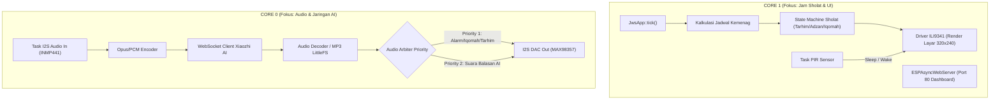

# 📋 Cetak Biru Integrasi Firmware: Islami Smart AI Desktop (ESP32-S3 N16R8)

Dokumen ini disusun sebagai panduan teknis implementasi (Pull Request Blueprint) untuk memadukan sistem **JWS (Jadwal Waktu Sholat)** dengan **Xiaozhi AI Voice Assistant** pada mikrokontroler **ESP32-S3 N16R8 (16MB Flash, 8MB PSRAM)**.

---

## 1. Konfigurasi Lingkungan (`platformio.ini`)

Tambahkan environment baru berdampingan dengan profil yang sudah ada tanpa merusak `hd_wf2` atau `sim`:

```ini
[env:desktop_s3_xiaozhi]
platform = espressif32
board = esp32-s3-devkitc-1
framework = arduino
board_build.mcu = esp32s3
board_build.f_cpu = 240000000L
board_build.flash_mode = qio
board_build.flash_size = 16MB
board_build.partitions = partitions_16MB_custom.csv
build_flags = 
    -D BOARD_HAS_PSRAM
    -D ARDUINO_USB_CDC_ON_BOOT=1
    -D CORE_DEBUG_LEVEL=1
    -D JWS_DESKTOP_S3=1
    -D TFT_ILI9341_SPI=1
    -D AUDIO_I2S_MAX98357=1
    -D MIC_I2S_INMP441=1
lib_deps = 
    bblanchon/ArduinoJson @ ^6.21.4
    adafruit/Adafruit GFX Library @ ^1.11.9
    adafruit/Adafruit ILI9341 @ ^1.6.0
    greiman/SdFat @ ^2.2.2
    earlephilhower/ESP8266Audio @ ^1.9.7
    links2004/WebSockets @ ^2.4.1
```

---

## 2. Pemetaan Pin GPIO ESP32-S3 N16R8 (Bebas Konflik)

> [!CAUTION]
> **PANTANGAN KERAS:** Jangan gunakan **GPIO 33, 34, 35, 36, dan 37** karena terhubung langsung ke chip internal Octal PSRAM. Hindari juga strapping pins pada boot (**GPIO 0, 45, 46**).

| Fungsi / Modul | Pin Modul | Pin GPIO ESP32-S3 | Catatan Sinyal |
| :--- | :--- | :--- | :--- |
| **Layar TFT SPI (ILI9341)** | VCC | 3.3V / 5V | Tegangan logika 3.3V |
| | GND | GND | Ground bersama |
| | CS | **GPIO 10** | Chip Select Display |
| | RESET (RST) | **GPIO 14** | Reset Display |
| | DC (RS) | **GPIO 13** | Data / Command |
| | SDI (MOSI) | **GPIO 11** | SPI Master Out |
| | SCK (CLK) | **GPIO 12** | SPI Clock |
| | LED (BLK) | **GPIO 21** | Backlight PWM Control |
| | SDO (MISO) | **GPIO 9** | SPI Master In (Opsional) |
| **I2S Output (MAX98357)** | VIN | **5V (VBUS)** | Wajib 5V untuk tenaga 3W optimal |
| | GND | GND | Ground |
| | BCLK | **GPIO 15** | Bit Clock Audio Out |
| | LRC (WS) | **GPIO 16** | Word Select Audio Out |
| | DIN | **GPIO 17** | Data Out ke Speaker |
| | GAIN / SD | GND / Unconnected | Default 9dB / Right channel |
| **I2S Input (INMP441 Mic)** | VDD | **3.3V** | Dilarang colok ke 5V! |
| | GND | GND | Ground |
| | SCK | **GPIO 4** | Clock Mic |
| | WS | **GPIO 5** | Word Select Mic |
| | SD | **GPIO 6** | Serial Data dari Mic |
| | L/R | GND | Left Channel Selection |
| **Sensor PIR (HC-SR501)** | VCC | **5V** | Butuh minimal 4.5V |
| | GND | GND | Ground |
| | OUT | **GPIO 7** | Digital Input (Sinyal gerak 3.3V) |
| **Relay Modul 3.3V** | VCC | **3.3V** | Menggunakan modul 3.3V yang dibeli |
| | GND | GND | Ground |
| | IN1 | **GPIO 8** | Kontrol Saklar Ampli Eksternal |
| | IN2 | **GPIO 18** | Kontrol Lampu / Cadangan |

---

## 3. Arsitektur Dual-Core (FreeRTOS Multitasking)



* **Core 1 Task:** Menjalankan `loop()` utama untuk kalkulasi astronomi jadwal sholat, refresh tampilan TFT 320x240, dan web dashboard. Waktu jam dijamin presisi tanpa freeze.
* **Core 0 Task:** Didedikasikan untuk streaming audio mikrofon, kompresi suara, koneksi WebSocket Xiaozhi AI, serta pembacaan file audio tarhim dari LittleFS.

---

## 4. Logika State Machine Sholat & Audio

Alur transisi status perangkat di `Core 1`:

```
IDLE (Jam Meja Standby)
   │
   ├─► [Waktu = Jadwal Sholat - TarhimOffset] (misal H-10 menit):
   │     • State: TARHIM
   │     • Aksi: Relay 1 ON -> Play MP3 Tarhim (LittleFS) -> Teks Layar "Persiapan Sholat"
   │
   ├─► [Waktu = Tepat Jam Sholat (00:00)]:
   │     • State: ADZAN / ALARM
   │     • Aksi: Stop Tarhim -> Play Audio Adzan/Chime -> Layar Teks "WAKTU SHOLAT [NAMA]"
   │
   ├─► [Waktu = Selesai Durasi Adzan]:
   │     • State: IQOMAH_COUNTDOWN
   │     • Aksi: Layar menampilkan hitung mundur (misal 10:00 -> 00:00)
   │     • 10 Detik Terakhir (00:10 s/d 00:01): Beep 100ms di tiap detik
   │     • Detik 00:00: Beep Panjang 1.5 detik tanda sholat dimulai
   │
   ├─► [Waktu = Sholat Berlangsung (10-15 Menit)]:
   │     • State: PRAYER_SILENT
   │     • Aksi: Relay OFF -> Layar mati/blank (tampil tulisan redup "RAPATKAN SHAF") -> AI Mute
   │
   └─► [Selesai Sholat]:
         • Kembali ke State: IDLE
```

---

## 5. Integrasi Xiaozhi AI Voice Assistant

### A. Komunikasi Suara & AI
* Menggunakan protokol WebSocket/HTTP client terenkripsi ke server Xiaozhi.
* **Format Audio:** 16kHz, 16-bit Mono PCM / Opus format.
* **Half-Duplex Audio Protection:** Saat MAX98357 memutar jawaban AI atau audio adzan, rekaman Mic INMP441 dinonaktifkan sementara (*software mute*) untuk mencegah *acoustic feedback* (gema suara sendiri).

### B. Tampilan Ekspresi di Layar TFT
* **State Normal (Idle):** Tampilan JWS penuh (Jam, Hijriyah, 7 Waktu Sholat, Running Text).
* **State Listening / Responding:**
  * Header atas mengecil tetap menampilkan jam & jadwal sholat berikutnya.
  * Area tengah menampilkan animasi mata robot dinamis (kedip, mendengarkan, berpikir, berbicara).
  * Batang equalizer audio dinamis bergerak mengikuti amplitudo suara.
  * Balon teks transkrip tanya-jawab ditampilkan di bawahnya.
* **Selesai Bicara (Timeout 5 detik tanpa suara):** Layar transisi halus kembali ke tampilan jam normal.

---

## 6. Hemat Daya Otomatis (Sensor PIR HC-SR501)
* Dijalankan sebagai task ringan interval 500ms.
* Jika tidak ada gerakan selama `sleepTimeoutMinutes` (default 5 menit) dan status sedang `IDLE`:
  * Kirim sinyal PWM ke `GPIO 21` (Backlight TFT) untuk meredupkan atau mematikan layar (0% brightness).
  * Menjaga ESP32 tetap dingin dan awet.
* Begitu ada gerakan terdeteksi atau saat masuk waktu tarhim/sholat:
  * PWM Backlight langsung kembali ke tingkat kecerahan normal (100%).

---

## 7. Ketahanan Sistem (Offline Fallback)
* Jika koneksi Wi-Fi putus atau server Xiaozhi tidak merespons:
  * Sistem JWS, jam RTC, kalkulasi jadwal, alarm suara lokal, hitung mundur iqomah, dan sensor PIR **tetap beroperasi 100% tanpa gangguan**.
  * Di layar hanya akan muncul indikator kecil `[AI Offline]` tanpa memicu sistem crash atau hang.
